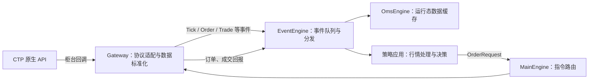

# 从 VeighNa 源码理解交易系统

这页把课程中的三个层次串成一条闭环：底层接口负责连接柜台并转换数据，中层引擎负责分发事件、维护状态和路由指令，策略应用负责根据数据作出决策。

## 先看整体关系

## 一、底层接口：统一数据，统一业务入口

### 数据结构标准化

不同柜台的字段名称、枚举值、时间格式和订单号规则不同。Gateway 把这些原生数据转换为框架对象，例如 `TickData`、`OrderData`、`TradeData`、`PositionData` 和 `ContractData`。

例如 CTP 的深度行情回调最终被转换为 `TickData`，策略只处理统一的 `last_price`、买卖盘、成交量和 `vt_symbol`，不需要直接解析 CTP 原生字典。方向、开平、订单状态也映射成统一枚举。

源码入口：[标准对象](../raw/vnpy/vnpy/trader/object.py)、[统一枚举](../raw/vnpy/vnpy/trader/constant.py)、[CTP 字段映射与回调](../raw/vnpy_ctp/vnpy_ctp/gateway/ctp_gateway.py)。

### 业务流程标准化

`BaseGateway` 为不同柜台规定共同操作：连接、关闭、订阅、报单、撤单、查询账户和持仓。上层调用 `MainEngine.subscribe()` 或 `MainEngine.send_order()`，再由指定 Gateway 转交给具体柜台。

标准化的重点是稳定接口契约，不代表每个柜台能力完全相同。某些订单类型、停止单、历史查询或重连行为仍取决于具体 Gateway。

源码入口：[BaseGateway](../raw/vnpy/vnpy/trader/gateway.py)、[MainEngine](../raw/vnpy/vnpy/trader/engine.py)、[CTP Gateway](../raw/vnpy_ctp/vnpy_ctp/gateway/ctp_gateway.py)。

## 二、中层引擎：分发、记忆和路由

### 事件引擎总线

`EventEngine` 把柜台推送变成带类型的事件，排入队列，再交给订阅该事件的处理函数。比如 `eTick.` 表示通用行情事件，`eTick.rb2701.SHFE` 一类事件可以面向指定合约。

当前源码使用一个事件消费线程按顺序执行 handler，并另设定时器产生 `eTimer`。因此 handler 应快速完成状态更新和策略回调；耗时计算、文件读写或等待网络会阻塞后续事件。

源码入口：[EventEngine](../raw/vnpy/vnpy/event/engine.py)、[事件类型](../raw/vnpy/vnpy/trader/event.py)、[Gateway 事件发布](../raw/vnpy/vnpy/trader/gateway.py)。

### OMS 数据缓存

`OmsEngine` 订阅 Tick、委托、成交、持仓、账户、合约和报价事件，维护程序运行期间的最新状态。策略和界面可以通过 `MainEngine.get_tick()`、`get_order()` 等方法快速查询。

它是运行态状态缓存，不等于历史数据库或永久账本。重启后需要由柜台查询、数据库或策略持久化恢复相关状态。OMS 还按 Gateway 管理 `OffsetConverter`，帮助处理不同持仓模型下的开平方向转换。

源码入口：[OmsEngine 与 OffsetConverter 调用](../raw/vnpy/vnpy/trader/engine.py)。

### 交易指令路由

策略先生成标准 `OrderRequest`，其中包含合约、方向、开平、类型、价格和数量。CTA 引擎按合约找到所属 Gateway，处理价格/数量取整及开平转换，再由 `MainEngine.send_order()` 路由给 Gateway。

Gateway 返回委托 ID 后，委托是否接受、成交或撤销仍需等待异步回报。回报转换成 `OrderData` / `TradeData` 事件，再经过事件总线更新 OMS，并回调对应策略。一次下单因此是“发出请求—返回本地委托标识—接收异步状态变化”的流程。

源码入口：[MainEngine 路由和 OMS 转换器](../raw/vnpy/vnpy/trader/engine.py)、[CTA 下单与委托关联](../raw/vnpy_ctastrategy/vnpy_ctastrategy/engine.py)、[CTP 请求和回报转换](../raw/vnpy_ctp/vnpy_ctp/gateway/ctp_gateway.py)。

## 三、策略应用：决策范围逐步扩大

### 单标的时序策略

策略围绕一个 `vt_symbol`，按时间顺序处理 Tick 或 Bar，维护指标和持仓状态，再通过 `buy`、`sell`、`short`、`cover` 等模板方法提交意图。CTA 引擎负责行情订阅、委托生命周期、本地停止单、持仓更新和回测驱动。

适合先学习：`CtaTemplate`、`BarGenerator`、`ArrayManager`、订单与成交回调。源码：[CTA 模板](../raw/vnpy_ctastrategy/vnpy_ctastrategy/template.py)、[CTA 引擎](../raw/vnpy_ctastrategy/vnpy_ctastrategy/engine.py)。

### 多标的投组策略

策略同时观察一组标的，在同一决策时点比较信号或风险，决定目标持仓、权重或资金分配，然后把组合调整拆成多个标的的订单。难点从单合约信号扩展为数据对齐、组合约束、资金分配、订单部分成交后的组合偏差管理。

阅读或实现时重点关注：

- 不同合约的行情时间和交易时段如何对齐。
- 目标权重如何换算为整数手数，并处理资金、保证金和风险上限。
- 某些订单未成交时，如何避免组合暴露长期偏离目标。

当前 `raw/` 中没有组合策略模块源码；以上是概念和学习检查点，不是对该模块具体实现细节的逐行解读。

### 价差套利类策略

价差策略把多个合约腿组合成一个逻辑交易对象，例如按比例构造 `spread = leg_A - ratio * leg_B`，基于价差而非单腿价格产生信号。真正执行时仍需分别处理各腿订单、成交和持仓。

核心风险是腿间异步：一条腿成交而另一条未成交，会暂时留下方向性敞口。因此要理解合约比例、价差行情、成交顺序、部分成交、对冲补单和异常退出。回测也需要明确价差两腿能否同时成交的撮合假设。

当前 `raw/` 中没有价差交易模块源码；本节用于建立理解框架，之后可克隆相应模块再按源码校正。

## 一笔 Tick 到成交回报

1. CTP 行情 API 推送原生深度行情。
2. CTP Gateway 转为 `TickData`，调用 `on_tick()` 发布事件。
3. EventEngine 将事件分发给 OMS 和订阅该合约的策略应用。
4. 策略计算信号并创建 `OrderRequest`。
5. CTA 引擎处理合约规则与委托归属；MainEngine 选择 Gateway 并转发请求。
6. CTP Gateway 将标准请求翻译成 CTP 字段并调用 TD API。
7. 柜台通过委托/成交回报异步更新状态；Gateway 再将其转换为标准事件。
8. OMS 更新缓存，CTA 引擎调用 `on_order()` / `on_trade()`，策略据此调整内部状态。

## 建议的源码练习

1. 在 [端到端调用链](source-integration-walkthrough.md) 中从 `onRtnDepthMarketData` 追到策略 `on_tick()`。
2. 从 `CtaTemplate.buy()` 追到 `CtpTdApi.send_order()`，记录每一层传递的数据类型和 ID。
3. 从 `onRtnOrder` / `onRtnTrade` 反向追到 OMS 缓存和策略回调。
4. 先实现一个单标的策略，再画出它扩展成投组或价差策略后新增的状态和失败路径。

## 来源与范围

- 概念框架：根目录 `-VeighNa.pdf` 的“以 VeighNa Trader 为例”架构页，以及本 Wiki 的源码阅读。
- 已对照源码：`raw/vnpy`、`raw/vnpy_ctp`、`raw/vnpy_ctastrategy`，版本信息见 [`raw/README.md`](../raw/README.md)。
- 多标的投组和价差套利部分是概念导读；对应模块尚未纳入本地源码阅读范围。
